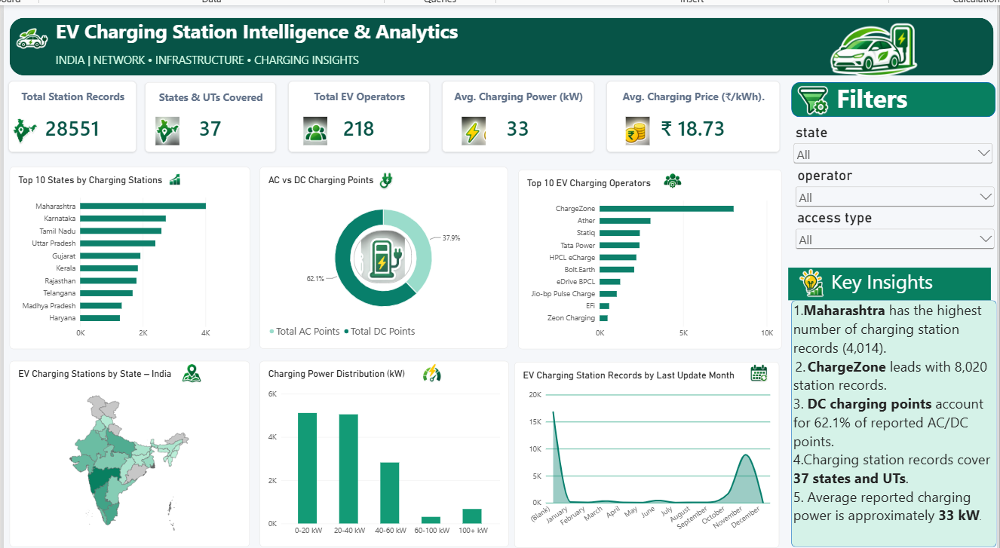

# ⚡ India EV Charging Station Intelligence & Analytics

**End-to-End Data Analytics Project | Python • MySQL • Power BI**

*Analyzing India's EV charging infrastructure through data-driven insights and interactive business intelligence.*

## 📌 Project Overview

An end-to-end data analytics project analyzing **28,551 EV charging station records across India** to uncover patterns in geographical distribution, charging infrastructure, operator presence, and charging capacity.

The project integrates **Python for data cleaning and exploratory analysis, MySQL for business analysis, and Power BI for interactive dashboard development.**

## 🛠️ Tech Stack

`Python` `Pandas` `Matplotlib` `MySQL` `Power BI` `Power Query`

## 🎯 Business Objectives

- Identify states and cities with the highest charging station presence.
- Analyze leading EV charging operators and networks.
- Compare AC/DC charging infrastructure and power capacity.
- Examine high-power charging stations and pricing data availability.
- Present actionable infrastructure insights through an interactive dashboard.

## 🔄 Analytics Workflow

| Stage | Implementation |
|---|---|
| **Data Preparation** | Cleaned 28,553 raw records, removed duplicates and unnecessary columns |
| **Python EDA** | Generated 10 visualizations exploring infrastructure patterns |
| **SQL Analysis** | Executed 12+ business-focused queries using MySQL |
| **Power BI** | Built an interactive dashboard with KPIs, charts, geographical analysis, and filters |

## 📊 Key Findings

| Business Metric | Result |
|---|---|
| 🏆 Highest Station Records by State | Maharashtra — **4,014** |
| 🏙️ Highest Station Records by City | Mumbai — **525** |
| 🔌 Leading Charging Operator | ChargeZone — **8,019 records** |
| ⚡ AC Charging Points | **15,322** |
| 🔋 DC Charging Points | **25,108** |
| 📈 Average Reported Maximum Power | **33.32 kW** |
| 🚀 Highest Reported Maximum Power | **375 kW** |

**Additional Finding:** Missing pricing, connector, and charging power information highlights important data quality challenges.

*Note: Findings represent records in the analyzed dataset and do not establish real-time operational availability.*

## 📈 Interactive Power BI Dashboard

Developed a single-page interactive dashboard presenting EV charging infrastructure through KPI summaries, geographical analysis, operator comparisons, charging capacity visuals, and interactive filters.



**Dashboard Source:** Explore the `PowerBI/` folder to access the Power BI project file.

## 📂 Repository Structure

```text
India-EV-Charging-Station-Analytics/
│
├── data/              # Cleaned dataset
├── python/            # Python analysis scripts
├── sql/               # SQL business queries
├── PowerBI/           # Dashboard and preview
├── output/charts/     # 10 EDA visualizations
├── requirements.txt   # Python dependencies
└── README.md
```

## 💡 Skills Demonstrated

**Data Cleaning** • **Exploratory Data Analysis** • **SQL Business Analysis** • **Data Visualization** • **Power Query** • **Power BI Dashboard Development**

---

**Project Outcome:** Developed an end-to-end analytics portfolio project combining Python, SQL, and Power BI to transform EV charging infrastructure records into interpretable business insights.
